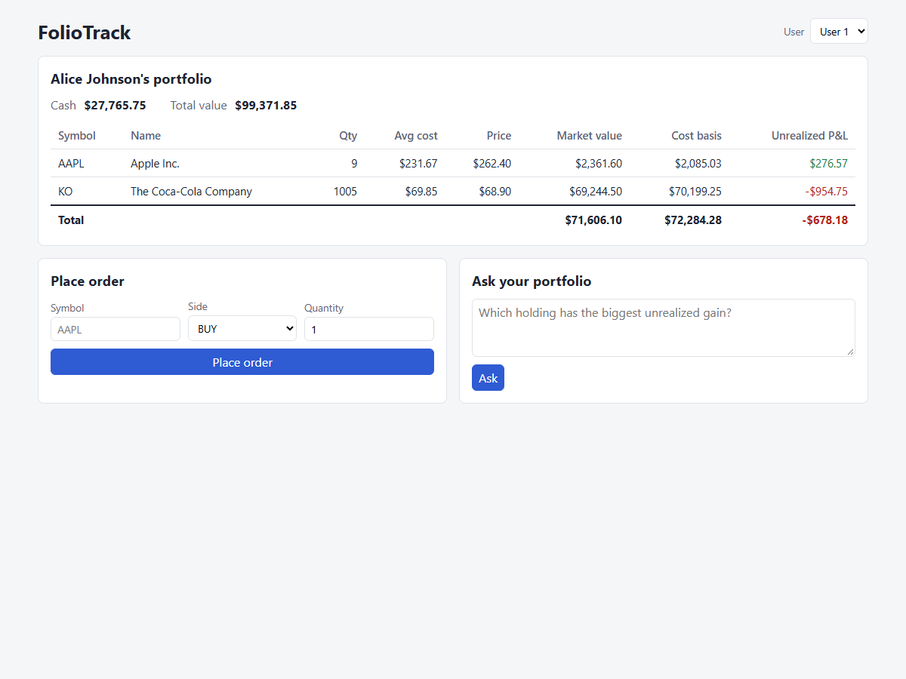
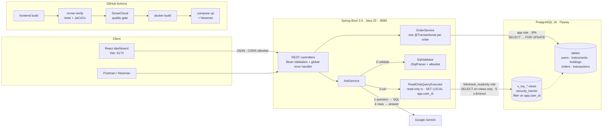

# FolioTrack

A portfolio and trade-management REST API in Spring Boot and PostgreSQL. You can hold cash and stocks, place market orders safely under concurrency, track P&L and history, and ask questions about your portfolio in plain English through a guarded GenAI SQL pipeline.

[](https://github.com/Pranav-146/FolioTrack/actions/workflows/ci.yml)
[](https://sonarcloud.io/summary/new_code?id=Pranav-146_FolioTrack)
[](https://sonarcloud.io/summary/new_code?id=Pranav-146_FolioTrack)



More screenshots: [filled order](docs/screenshots/order-filled.png) · [rejected order](docs/screenshots/order-rejected.png) · [ask your portfolio](docs/screenshots/ask.png) · [error handling](docs/screenshots/error.png)

## Features

- **Portfolio:** cash, holdings, market value, cost basis and unrealized P&L per holding and in total.
- **Orders:** BUY/SELL market orders at the current price, with a weighted average cost. Orders that fail a business rule (not enough cash or shares) are stored as `REJECTED` with a reason.
- **History:** paginated order and transaction history, newest first.
- **Ask your portfolio:** a plain-English question goes to the LLM, which writes SQL. The SQL is validated and run read-only, scoped to your data, and the result comes back as a plain-English answer (Google Gemini).
- **React dashboard:** portfolio table, order form and ask box (Vite, in [`frontend/`](frontend/)).
- **Market simulation:** `PUT /api/instruments/{symbol}/price` moves prices so P&L changes.

## Architecture



## Tech stack

| Area | Tools |
|---|---|
| Backend | Java 25, Spring Boot 3.5 (Web, Data JPA, Validation), springdoc-openapi (Swagger UI) |
| Database | PostgreSQL 16, Flyway migrations, `NUMERIC` money columns |
| GenAI | Google Gemini (model set via `LLM_MODEL`), JSqlParser for SQL validation |
| Frontend | React 19, Vite 8 |
| Testing | JUnit 5, Mockito, `@WebMvcTest` + MockMvc, JaCoCo, Postman/Newman |
| DevOps | Docker (multi-stage), Docker Compose, GitHub Actions, SonarCloud, reference Jenkinsfile |

## Key engineering decisions

**Pessimistic locking for concurrent orders.** Every order first loads the user row with `PESSIMISTIC_WRITE` (`SELECT … FOR UPDATE`, see [`UserRepository`](src/main/java/com/foliotrack/repository/UserRepository.java)). Orders for the same user therefore run one at a time, and the cash and holdings checks can't go stale. It was chosen over optimistic `@Version` locking because many clicks on one account are exactly the case where optimistic locking fails and needs a retry loop. Orders for different users don't block each other. *Proof:* [`scripts/concurrency-check.sh`](scripts/concurrency-check.sh) fires 20 parallel BUYs that only 14 can afford. Result: 14 filled, 6 rejected, final cash exactly start − 14 × cost, no overspend.

**One `@Transactional` method per order, with rollback.** Debiting cash, upserting the holding, and saving the order and its transaction all happen in one transaction, so if any step fails nothing is saved. *Proof:* [`scripts/rollback-check.sh`](scripts/rollback-check.sh) installs a temporary trigger that makes the final `transactions` insert fail. The API returned 500, and the user's cash, holding and order count were unchanged.

**BigDecimal end to end.** Money is `NUMERIC(15,2)` / `NUMERIC(12,2)` in Postgres and `BigDecimal` in Java (average cost rounded `HALF_UP` to 2 dp), and never a `double`. The frontend does **no money math**. It only formats values the backend has already computed ([`format.js`](frontend/src/format.js)), because JavaScript numbers are binary floats.

**A rejected order returns `201`.** A BUY you can't afford still creates and stores an order resource, with `status: REJECTED` and a reason. That is a business outcome, not a client error. `4xx` is reserved for bad input (`400`) and unknown users or symbols (`404`).

**GenAI defense in depth.** The LLM writes SQL, so every layer assumes the one before it can fail:
1. **Prompt:** a versioned template ([`ask-sql-v1.txt`](src/main/resources/prompts/ask-sql-v1.txt)) shows the LLM only the user-scoped views, with few-shot examples.
2. **Validator:** [`SqlValidator`](src/main/java/com/foliotrack/service/SqlValidator.java) allows only a single `SELECT`, with no `;`, `--` or `/*`. It blocks write/DDL keywords plus `SET` and `INTO`, and blocks functions such as `set_config` and `pg_*`. JSqlParser must parse the query and find only allowlisted views. The query is then wrapped as `SELECT * FROM (<query>) q LIMIT 100`. A query that fails these checks returns `422` and never runs.
3. **Database:** the query runs on a separate `foliotrack_readonly` role ([V3 migration](src/main/resources/db/migration/V3__ask_views_and_readonly_role.sql)).
   - The role has `SELECT` on the `v_my_*` views only. The views are `security_barrier` and filter on `current_setting('app.user_id')`.
   - The executor sets `app.user_id` with `SET LOCAL` inside a read-only transaction that is always rolled back.
   - There is a 5 s `statement_timeout`, and `set_config` is revoked from `PUBLIC`.

**CORS allowlist.** Only the dashboard origin (`http://localhost:5173`, configurable) can call the API from a browser, and only with `GET`/`POST` ([`CorsConfig`](src/main/java/com/foliotrack/config/CorsConfig.java)).

**Supply-chain hardening.**
- Exact npm versions (`save-exact`) with a committed `package-lock.json`.
- CI installs with `npm ci --ignore-scripts`, and [`.npmrc`](frontend/.npmrc) disables install scripts.
- Newman is pinned to `6.2.3`, installed with `--ignore-scripts` and run without `npx`.
- Maven plugin versions are pinned.
- The CI token has `contents: read` only.
- Secrets live in `.env`, which is gitignored; only `.env.example` is committed.

## Testing & quality

| What | Result |
|---|---|
| Unit + controller tests (`./mvnw verify`, no DB needed) | **158 tests**, 0 failures |
| SonarCloud quality gate | **Passed**. Ratings A / A / A (reliability, security, maintainability) |
| Coverage (JaCoCo → SonarCloud, backend only) | **90.3 %** line, **89.4 %** branch |
| Bugs / vulnerabilities / code smells / duplication | **0 / 0 / 0 / 0 %** |
| Postman collection via Newman (in CI against docker compose) | **26 requests, 96 assertions**, 0 failures |

- **Service tests were written first** for order execution: buy, sell, insufficient cash or holdings, average cost, unknown symbol, invalid quantity. Repositories and the LLM client are mocked with Mockito.
- **`SqlValidator` tests** cover allowed queries plus injection attempts: stacked statements, comments, forbidden keywords and functions, Unicode-escaped identifiers, and non-allowlisted tables.
- **Manual checks** run against a local dev stack, not in CI, and both pass. They need bash (Git Bash on Windows) and the running `docker compose` stack. Both change the dev data, so don't run them anywhere else.
  ```bash
  scripts/concurrency-check.sh 1 KO   # [USER_ID] [SYMBOL]
  scripts/rollback-check.sh 2 KO      # always drops its trigger on exit, even on failure
  ```

## CI/CD

[`.github/workflows/ci.yml`](.github/workflows/ci.yml) runs on every push and pull request to `main`:

| Job | Steps |
|---|---|
| `build` | checkout (full history for Sonar) → Temurin 25 + Node 22 → **build frontend** (`npm ci --ignore-scripts && npm run build`) → **`./mvnw verify`** (tests + JaCoCo) → upload reports → **SonarCloud scan** with `sonar.qualitygate.wait=true` (a failed gate fails the build) → **`docker build`** |
| `api-smoke-test` (needs `build`) | `docker compose up --build` (app + Postgres) → wait for the API → **Newman** runs the Postman collection → tear down |

**Jenkins mapping.** [`Jenkinsfile`](Jenkinsfile) is a **reference only and is not run** for this repo. It shows the same pipeline as Jenkins stages:

| Jenkins stage | GitHub Actions equivalent |
|---|---|
| Checkout | `actions/checkout` |
| Build (`package -DskipTests`) | covered by `./mvnw verify` |
| Test (`verify`, JUnit + JaCoCo archive) | `./mvnw verify` + upload reports |
| SonarCloud analysis | SonarCloud scan step |
| Quality gate (`waitForQualityGate`) | `-Dsonar.qualitygate.wait=true` |
| Docker build | `docker build` step |
| *(not in Jenkinsfile)* | frontend build, `api-smoke-test` job |

## API

Interactive docs: **http://localhost:8080/swagger-ui.html**. Every error uses one JSON shape: `timestamp, status, error, message, path, fieldErrors`.

| Method | Path | Purpose | Success | Errors |
|---|---|---|---|---|
| `GET` | `/api/users/{id}/portfolio` | Cash, holdings, P&L, totals | 200 | 404 |
| `POST` | `/api/users/{id}/orders` | Market order `{symbol, side, quantity}` | 201 (`FILLED` or `REJECTED`) | 400, 404 |
| `GET` | `/api/users/{id}/orders?page=&size=` | Order history, newest first | 200 | 400, 404 |
| `GET` | `/api/users/{id}/transactions?page=&size=` | Transaction history, newest first | 200 | 400, 404 |
| `GET` | `/api/instruments` | Instruments and current prices | 200 | — |
| `PUT` | `/api/instruments/{symbol}/price` | Set price `{price}` (simulate market) | 200 | 400, 404 |
| `POST` | `/api/users/{id}/ask` | Ask a question `{question}` → `{question, sql, rowCount, answer}` | 200 | 400, 404, 422 (unsafe SQL), 503 (LLM unavailable) |

Paging: `page` defaults to 0, `size` defaults to 20 (1–100).

## Run locally

Prerequisites: Docker, and Node 22 for the dashboard. Java 25 is only needed to build or test outside Docker.

```bash
cp .env.example .env              # set the two passwords; LLM_API_KEY is optional (only /ask needs it)
docker compose up -d --build      # Postgres + API on http://localhost:8080 (Flyway seeds 3 users, 10 instruments)

cd frontend
npm ci                            # .npmrc already disables install scripts
npm run dev                       # dashboard on http://localhost:5173
```

Other commands:
- Run tests: `./mvnw verify`.
- Run the API from source: `docker compose up -d db`, then `./mvnw spring-boot:run`.
- Run the Postman suite: `newman run postman/FolioTrack.postman_collection.json -e postman/FolioTrack.local.postman_environment.json`.

## Known limitations

- **Plain `SET app.user_id = …` is not blocked by the database.** Any role can set a custom setting. It is blocked only by the validator (which rejects the `SET` keyword) and by the `SELECT * FROM (…)` wrapper, where a `SET` statement can't parse. (`set_config()` *is* revoked at the DB level.)
- **The frontend is outside Sonar's scope.** The scan covers `src/main` only, so all coverage numbers are backend-only. CI just checks that the frontend builds.
- **The Jenkinsfile is reference-only.** It has never been run. CI is GitHub Actions.
- **There is no authentication.** The user id is a path parameter, so any caller can act as any user. This is a demo; real use would need auth with the user id taken from the token.
- **Gemini's free tier may use prompts for training.** Questions and query results (portfolio data) are sent to Google. Use demo data only.
- **Newman's transitive dependencies aren't lockfile-pinned.** `newman@6.2.3` is pinned, but its dependency tree is resolved at install time.

## More

- [User stories](docs/USER_STORIES.md) with acceptance criteria and story points
- [Project specification](SPEC.md)
